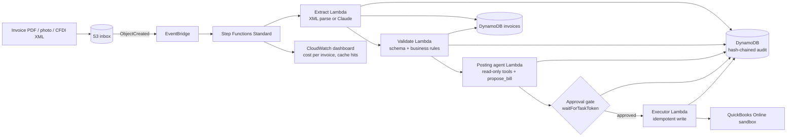

# InvoiceFlow architecture (planned)

This is the target design for v1.0. Each section says which milestone builds it.

## Components

| Path | Component | Milestone |
|---|---|---|
| `src/invoiceflow/llm/` | Model IDs, `complete()`, stop_reason handling, cost from usage | M0 |
| `evals/`, `data/` | Eval set with CFDI XML ground truth, baseline, metrics | M1 |
| `src/invoiceflow/extraction/` | Deterministic CFDI XML parser, Claude structured extraction, fallback | M1-M2 |
| `src/invoiceflow/validation/` | Pydantic schema + business rules (totals, RFC/EIN, dates) | M2 |
| `infra/modules/`, `infra/envs/dev/` | S3, EventBridge, Step Functions, Lambda, DynamoDB, IAM, OIDC | M3 |
| `src/invoiceflow/handlers/` | Lambda entry points | M3 |
| guardrails (in extraction/validation) | PII redaction, prompt-injection defenses + test set | M4 |
| `src/invoiceflow/agent/` | Posting agent: tool loop, read-only QuickBooks tools, propose_bill | M5 |
| `src/invoiceflow/approvals/` | Approval gate (task tokens, signed links) and executor | M6 |
| `src/invoiceflow/audit/` | Hash-chained audit log + `verify-audit` | M6 |
| `docs/` | README, ADRs, demo video, interview pack | M7 |

## Milestones

| Milestone | Target date | Output |
|---|---|---|
| M0 Foundations | 2026-11-29 | Accounts, budget alarms, CI, metered smoke call |
| M1 Eval set + baseline | 2026-12-06 | Ground truth from CFDI XML, pdfplumber/regex baseline |
| M2 Claude extraction | 2026-12-13 | Structured outputs, validation, fallback; model comparison on quality and cost |
| M3 AWS pipeline | 2026-12-20 | Deployed event-driven pipeline -> **v0.1.0 minimum shippable version** |
| M4 Guardrails | 2026-12-27 | PII redaction, injection test set and defenses |
| M5 Posting agent | 2027-01-03 | Agent proposes bills with read-only tools |
| M6 Safe writes | 2027-01-10 | Approval gate, idempotent executor, audit chain |
| M7 Ship pack | 2027-01-15 | **v1.0.0**: README, ADRs, video |

## Key design rules
- Deterministic first: parse CFDI XML without an LLM when it exists.
- The agent never holds write credentials. It proposes; the executor writes after approval.
- Every write carries an idempotency key; approving twice creates one bill.
- Every LLM call reports cost from `usage`.
